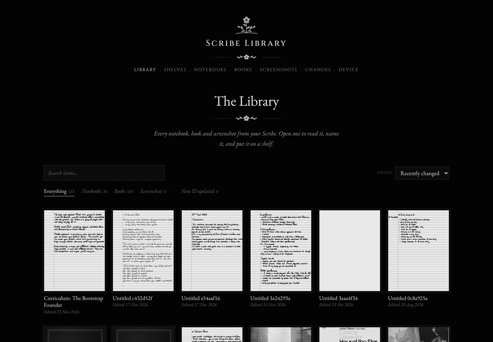
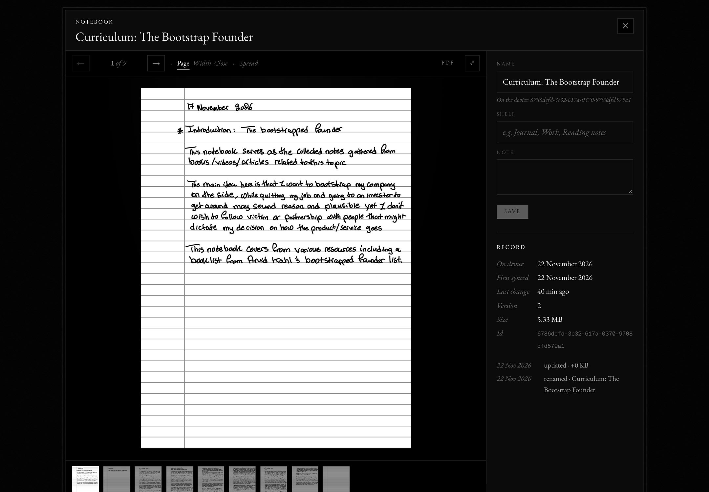
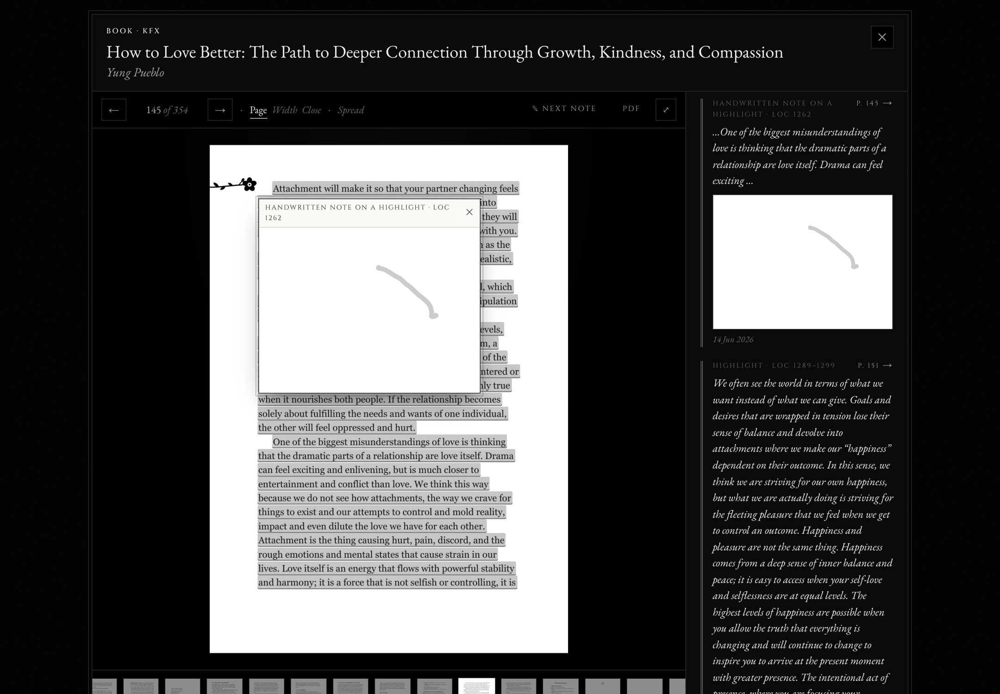

# Scribe Library

A local library for your Kindle Scribe: handwritten notebooks, books
(purchased and sideloaded) and screenshots, synced over USB and read offline.
Name and shelve your notebooks, see what changed since the last sync, and pull
your highlights and handwritten notes out of the books you've written in.



<table>
  <tr>
    <td width="50%"></td>
    <td width="50%"></td>
  </tr>
  <tr>
    <td><em>A notebook, named locally and tracked across syncs.</em></td>
    <td><em>A book at a handwritten note: the highlight is shaded and the note blooms in the margin.</em></td>
  </tr>
</table>

```bash
npm install
npm run dev     # http://localhost:3000, with the engine on :7070
```

Plug in the Scribe, unlock it, and press **Sync everything** on the Device
page.

## What's new

The November 2026 refresh rebuilt the app around a library you can tend:

- **A new look.** Next.js 16 + Tailwind 4 in a dark-academia style, set in
  Garamond and Cinzel, with botanical ornaments: a library as a garden of
  knowledge.
- **A local registry** (`library/scribe.db`). Rename notebooks from their
  UUIDs, put things on **shelves**, keep notes, and see what's **new or
  updated** since you last opened it, with a dated **Changes** log.
- **Your marginalia, in place.** Highlights and handwritten notes are read
  straight from the Scribe's `.yjr` files and in-book notebooks, resolved to
  exact text and Kindle locations, and drawn on the page: shaded highlights,
  a flowering branch for each note. Export them as Markdown.
- **Active Canvas notes** (which the Scribe doesn't anchor anywhere USB can
  read) are placed from where you were reading when you wrote them.
- **Better syncing.** Edits are detected by the device's modification time as
  well as size, screenshots in the newer `screenshots/` folder are found, and
  text books render again with WeasyPrint 70.

## What it does

- **Library.** Everything as volumes on a shelf. Click one and it opens in
  place into a plate with the reader on the left and its details on the right.
  Notebooks, Books and Screenshots each have their own page too.
- **Your names, your shelves.** The Scribe names notebooks by UUID. Give any
  item a name, a shelf and a note; they're kept in a local SQLite registry, so
  they survive every resync. The device's own name is still shown underneath.
- **Shelves.** The Shelves page lets you create shelves (even empty ones),
  put notebooks, books and screenshots on them, rename them (their items
  follow) and remove them (their items stay, unshelved). Typing a new shelf
  name on an item creates that shelf too.
- **What changed.** Every sync is reconciled against the registry. New items
  show as *New*, notebooks you've written in since show as *Updated* (until you
  open them), and the **Changes** page keeps a dated log: added, updated,
  removed, restored, renamed.
- **Highlights & handwritten notes in books.** Opening a book lists its
  highlights with their exact text and Kindle location, and the notes you
  handwrote in it as images at the location you wrote them. **Export .md**
  downloads them all. On the page itself, highlighted passages are shaded
  line by line, and a small flowering branch in the margin marks each
  handwritten note (click it to see the note there). A note written inside a
  highlight blooms beside the start of that highlighted passage. Click
  any note or highlight in the side panel to turn to it; **✎ Next note** (or
  `n`) walks through the pages with handwriting, and the page strip marks
  them. How this works: [docs/annotations.md](docs/annotations.md).
- **Reader.** Page or width fit, close-up, two-page spread, page strip,
  full screen (`f`), arrow keys to turn pages, `esc` to close.
- **Device.** Sync, push a PDF/EPUB/etc. to the Kindle, delete screenshots from
  both sides, clear the render cache.

## Setup

**System libraries** (for notebook rendering, book typesetting and USB):

```bash
brew install cairo pango libusb                  # macOS
sudo apt install libcairo2 libpango-1.0-0 libusb-1.0-0   # Debian/Ubuntu
```

**Python 3.10+ and Node 22.12+** (`nvm use` reads `.nvmrc`):

```bash
pip3 install -r requirements.txt
npm install
```

## Running it

```bash
npm run dev     # development: engine on :7070 + Next on :3000 (proxied)
npm run build   # build the UI to ./out
npm start       # production: the engine serves ./out on http://127.0.0.1:7070
npm run sync    # sync everything from the device, then serve
```

Once built, `python3 engine/server.py` on its own is enough: one process
serves the UI and the API. `python3 engine/launcher.py` opens it in a native
window (needs `pywebview`).

## Where things live

```
site.config.ts          app name and navigation
app/                    the UI (Next.js App Router, static export)
  global.css            design tokens + library/reader styles
  components/ui.tsx     shared building blocks (PageHeader, Section, StatusPill…)
  components/library.tsx  the shelf: search, filters, shelves, open-in-place
  components/shelves.tsx  the Shelves page: create, fill, rename, remove
  components/plate.tsx  an opened item: reader + name/shelf/note + history
  components/reader.tsx page reader
  components/marginalia.tsx  highlights & handwritten notes for a book
lib/engine.ts           typed client for the engine's API
engine/                 the Python engine
  server.py             Flask API (and serves ./out in production)
  registry.py           SQLite registry: names, shelves, notes, change tracking
  annotations.py        .yjr parser, positions → text/locations, handwriting render, export
  library.py            discovery and classification of synced files
  mtp_sync.py           USB MTP transport (sync, push, delete)
  nbk_to_pdf.py         notebook (KDF) → PDF
  kfx_to_pdf.py         book metadata, KFX/EPUB/AZW3 → PDF
  kfxlib/               vendored KFX Input library (GPL v3)
  tools/                diagnostics for annotation sidecars
docs/annotations.md     research: where the Scribe keeps annotations and how to export them
library/                your synced content (git-ignored)
  scribe.db             the registry
  notebooks/            <UUID>.nbk + <UUID>.png
  notebooks/in-book/    handwriting written inside books, <ASIN>.nbk
  books/purchased/      ASIN-named books
  books/sideloaded/     everything else, plus each book's .sdr sidecar
  screenshots/
```

Converted pages and extracted covers are cached in your system temp folder
(`scribe_reader_cache`), separate from the library, so clearing the cache never
touches your content.

## The registry

`library/scribe.db` is plain SQLite. Open it with any SQLite browser.

- `items`: one row per notebook/book/screenshot: `display_name`, `shelf`,
  `note`, `fingerprint` (SHA-1), `version`, `first_seen`, `last_changed`,
  `last_opened`, `removed_at`.
- `changes`: the log behind the Changes page.
- `shelves`: your shelves (name, description); items refer to them by name.
- `note_positions`: where Active Canvas notes sit in their book, recorded from
  your reading position since the device doesn't store it over USB.

An item is **Updated** when its content fingerprint changes after you last
opened it. Sync compares size *and* the device's modification time, so edits
that keep a notebook the same size are still pulled. The first sync is a
quiet baseline: nothing is flagged New. Removed files keep their row, so if
they come back their name and shelf come back too.

## What works

| Format              | Sync | Read in the app                 | Highlights & notes   | Push |
| ------------------- | ---- | ------------------------------- | -------------------- | ---- |
| Notebook (`.nbk`)   | ✓    | ✓ full handwriting              | n/a                  | n/a  |
| KFX book            | ✓    | ✓ typeset via WeasyPrint        | ✓ text + location + handwriting | n/a |
| KFX comic/manga     | ✓    | ✓ page images                   | ✓                    | n/a  |
| PDF                 | ✓    | ✓ paged                         | experimental overlay | ✓    |
| EPUB / AZW3         | ✓    | ✓ typeset via WeasyPrint        | –                    | ✓    |
| MOBI                | ✓    | download only                   | –                    | ✓    |
| Screenshot          | ✓    | ✓                               | n/a                  | n/a  |

## Troubleshooting

**Sync finds nothing.** The Kindle is locked, or the cable is charge-only.
Try `python3 engine/mtp_sync.py --detect --verbose`.

**"The engine isn't answering".** Start it: `npm run dev`, or
`python3 engine/server.py`.

**A notebook won't open.** Check the engine's console for kfxlib errors. New
firmware can add stroke types the decoder hasn't seen.

**A book says "download only".** kfxlib couldn't decode it, usually because
of DRM. Its highlights are still listed, without text.

**Port 3000 is taken.** Next picks the next free port; the console says which.

## License

`engine/kfxlib/` is GPL v3 by John Howell (jhowell), from
[kluyg/calibre-kfx-input](https://github.com/kluyg/calibre-kfx-input). The rest
of this project is GPL v3 because it links against that library.
